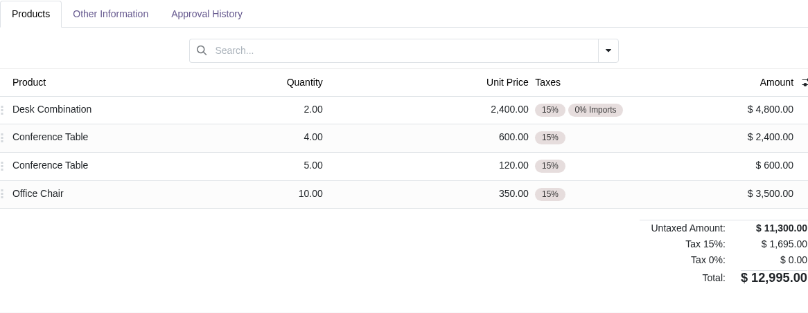
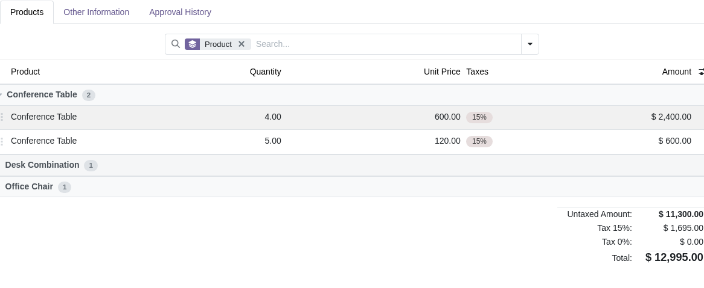
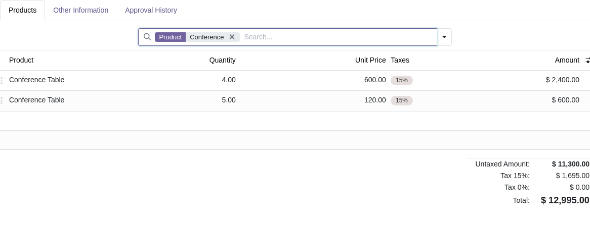
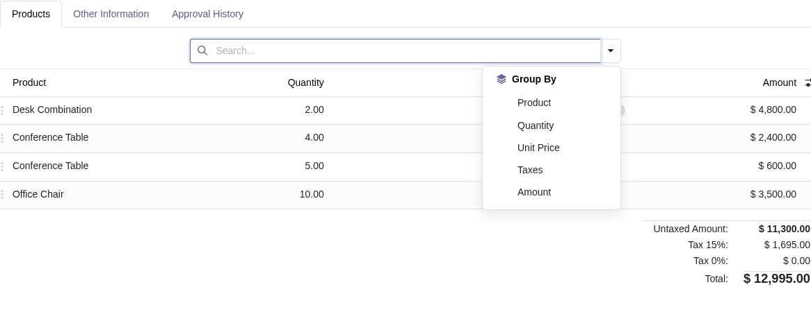

=================
X2many Search Bar
=================

Adds a client-side **search bar** and **group by** button above ``one2many`` / ``many2many``
list views inside notebook pages.

Features
--------

- **Centered Search Bar** — modern 3-column control panel layout (left action buttons, centered wide search bar, right pager) with responsive sizing.
- **Smart Field-Scoped Search** — type a query, pick a field from the dropdown, and only matching records are shown with facet chips.
- **Auto-Discovery of Visible Columns** — if ``search_fields`` is not configured, the widget automatically detects and uses all visible columns in the list view (skipping handle and invisible technical fields).
- **Dynamic Optional Column Sync** — toggling optional columns on/off in the list view header immediately updates the available search suggestions and Group By fields in real time.
- **Client-Side Group By** — group records by any visible or configured field, complete with collapse/expand accordions, count badges, and clean relational display names.
- **Facets in Insertion Order** — active filters and group-by chips appear as standard Odoo-style facets in chronological order.
- **Zero Server Round-Trips** — all filtering, grouping, and toggling happen entirely on client-side loaded records.
- **Section & Note Support** — automatically integrates with Odoo line-item architectures including ``product_label_section_and_note_field_o2m`` (Odoo 19) and ``section_and_note_one2many`` (Odoo 18/17) without hard dependencies.

Usage
-----

Add ``widget="x2many_search"`` to any ``one2many`` or ``many2many`` field and specify
the searchable/groupable fields via ``search_fields``::

    <field name="order_line" widget="x2many_search"
           options="{'search_fields': ['name', 'product_qty', 'price_unit']}"/>

Options
-------

``search_fields`` (list or comma-separated string, optional)
    Names of the fields to search and group by (e.g. ``['name', 'product_qty']`` or ``"name, product_qty"``).
    Values are matched case-insensitively as substrings. For ``many2one`` and relational fields, the display name is used.
    If omitted or empty, all columns currently visible in the list view are used automatically and sync dynamically as optional columns are toggled.

Search Bar — Behaviour
----------------------

1. Type a query → a dropdown appears listing available fields.
2. Click a field (or press **Enter** to auto-select the first) → a filter facet
   ``[Field]  value  ×`` appears in the search bar and records are filtered.
3. Press **Backspace** with an empty input to remove the last facet
   (filter first, then group by).
4. Click **×** inside a facet to remove it.
5. **ArrowDown / ArrowUp** navigate the dropdown; **Escape** closes it.

Group By — Behaviour
--------------------

1. Click the caret (**▾**) next to the search bar → the Group By menu opens.
2. Click a field → records are sorted and grouped, and a group facet appears in
   the search bar. Groups start **collapsed**; each header shows the group label
   and record count.
3. Click a group header to **collapse / expand** that group.
4. Click **×** on the group facet (or Backspace) to remove grouping.
5. Filter and group by can be active simultaneously; facets keep insertion order.

Notes
-----

- All operations are **client-side only**: only records loaded in the current page
  are affected. For paginated x2many fields the default page size is 80 records.
- The widget registers under the key ``x2many_search`` and supports both
  ``one2many`` and ``many2many`` field types.
- Standard options such as ``editable``, ``create``, ``delete``, ``no_open``, etc.
  continue to work alongside the new options.
- For **section/note** rows the column bound to ``name`` (usually *Description*)
  must be visible; if it is hidden via the optional-columns menu, section/note
  lines cannot be edited (this is standard Odoo behaviour).
- Compatible with Odoo 19 Community and Enterprise.

Technical
---------

- ``X2ManySearchField`` — extends ``X2ManyField``; manages search/group state,
  dynamic optional field synchronization (``onOptionalActiveFieldsChanged``),
  caches filtered/sorted record proxies, and passes ``groupField``, ``collapsedGroups``,
  ``groupCounts``, and ``onToggleGroup`` as props to the renderer.
- ``makeSearchListRenderer(Base)`` — factory that produces a search-aware list
  renderer from any base ``ListRenderer`` (shared group methods are mixed in via
  ``GroupMethods``). The custom ``rowsTemplate``
  (``ae_x2many_search.ListRenderer.Rows``) injects group header rows directly
  inside the native ``<tbody>`` render loop without extra component instances.
- Section/note is wired **without a hard dependency** on ``account``: the widget
  checks the ``fields`` registry for both ``product_label_section_and_note_field_o2m`` (Odoo 19)
  and ``section_and_note_one2many`` (Odoo 18/17), rebuilding its list renderer dynamically.
- Relational fields (e.g. ``many2one`` objects ``{ id, display_name }``) are handled natively
  by ``getFieldStringValue`` for both string search and clean group header labels.
- Proxy objects are ``markRaw``-wrapped to prevent OWL reactivity loops.
- Sort and filter results are cached by key and only recomputed when the underlying
  records or active query/field change.
